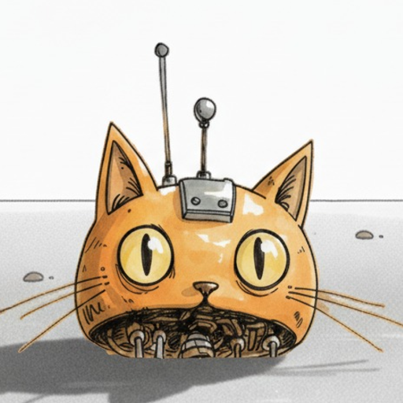

<p align="center">
  
</p>

<h1 align="center">mojo agent skills</h1>

<p align="center">
  Drop-in skills that teach any AI agent to be useful for <a href="https://mojoapp.ai">mojo</a> users on a GLP-1 weight loss journey.
</p>

---

[mojo](https://mojoapp.ai) is a weight-loss tracker purpose-built for GLP-1 medications (Mounjaro, Ozempic, Wegovy, Zepbound). This repository ships three small **skills** you can drop into your own AI agent (Claude Code, OpenClaw, or any runtime that loads `SKILL.md` files).

Each skill is plain text. No API calls. No telemetry. Nothing happens to your mojo account unless you tap a link the skill generates.

## The skills

### [`/mojo-ai-agent`](skills/mojo-ai-agent/) — log anything to mojo from a photo, a screenshot, or a sentence

Send an InBody or smart-scale screenshot, a food photo, or a line like "weighed 72.5 kg and drank 500 ml of water", and the agent replies with one **Import to mojo** link per record: meals, weight / body fat / skeletal muscle, visceral fat, waist, water, GLP-1 injections, and side effects. Each link also comes as a URL in a code block, so it can be copied and pasted into mojo when a chat app won't open the link.

> **You:** *[InBody result screenshot]*
>
> **Agent:** *[table of the values it read and what it left out…]*
>
> **Body measurement** — [Import to mojo](https://api.mojoapp.ai/measurement/add?weight=72.5&...)
>
> **Visceral fat** — [Import to mojo](https://api.mojoapp.ai/visceral-fat/add?level=9&...)

It works without an agent too: paste the contents of [`SKILL.md`](skills/mojo-ai-agent/SKILL.md) at the start of a chat in ChatGPT, Claude, or Gemini, then send your photos. In the Gemini app it also tells you how to get past Google's Redirect Notice (on iPhone, long-press the link).

### [`/mojo-glp1-knowledge`](skills/mojo-glp1-knowledge/) — your knowledgeable peer for GLP-1 questions

When you ask about Mounjaro, Ozempic, Wegovy, Zepbound, Saxenda, Rybelsus, or GLP-1 in general (瘦瘦針 / 減肥針 / 瘦瘦筆), the agent answers thoughtfully — drawing on a curated knowledge base plus its own medical training.

> **You:** Is the 10 mg Mounjaro KwikPen really only 10 mg total?
>
> **Agent:** No — 10 mg is per *weekly* dose. The pen holds 4 × 10 mg doses = 40 mg total. *[…explains pen geometry, corrects the common misconception, and adds one safety reminder…]*

Includes corrections for common misconceptions (dose vs. pen total, needle reuse, residual medication) and always pairs actionable advice with a clear disclaimer.

### [`/mojo-app-guide`](skills/mojo-app-guide/) — the mojo app user guide

The full user-facing documentation site (the same one at [docs.mojoapp.ai](https://docs.mojoapp.ai)) is bundled in four languages (`en`, `zh-TW`, `zh-Hant-HK`, `zh-Hans`). When you ask "how do I cancel my subscription", "how does the streak counter work", or "where do I enter my body fat", the agent reads the matching page and answers in your language.

---

## Install

Copy one of the prompts below and paste it to your AI agent (Claude Code, OpenClaw, or any agent that loads `SKILL.md` files).

**Install all three skills:**

```
Install the mojo agent skills from https://github.com/mojoapp-ai/agent-skills
```

**Or install one at a time:**

```
Install the mojo AI agent skill from https://github.com/mojoapp-ai/agent-skills/tree/main/skills/mojo-ai-agent
```

```
Install the mojo GLP-1 knowledge skill from https://github.com/mojoapp-ai/agent-skills/tree/main/skills/mojo-glp1-knowledge
```

```
Install the mojo app guide skill from https://github.com/mojoapp-ai/agent-skills/tree/main/skills/mojo-app-guide
```

---

## Privacy

- ❌ No API calls.
- ❌ No telemetry. No usage reporting.
- ❌ No data leaves your agent unless you tap a link a skill generates; a link carries only the values written in it to mojo (in Gemini, through Google's redirect).
- ✅ Each skill is one or more markdown files. You can read every byte before you install.

---

## Get mojo

- iOS: <https://apps.apple.com/app/id6751704399>
- Android: <https://play.google.com/store/apps/details?id=com.hanamizuki.mojo>
- Web: <https://mojoapp.ai>
- Docs: <https://docs.mojoapp.ai>

---

## License

[MIT](LICENSE). Use it, fork it, embed it, modify it. Underlying user-docs content (in `skills/mojo-app-guide/references/`) is © mojoapp.ai and bundled here under permission.
